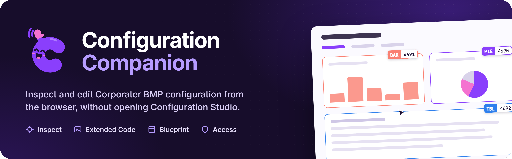
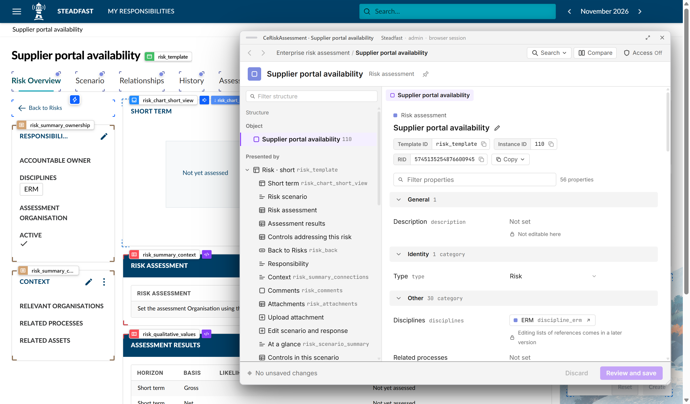
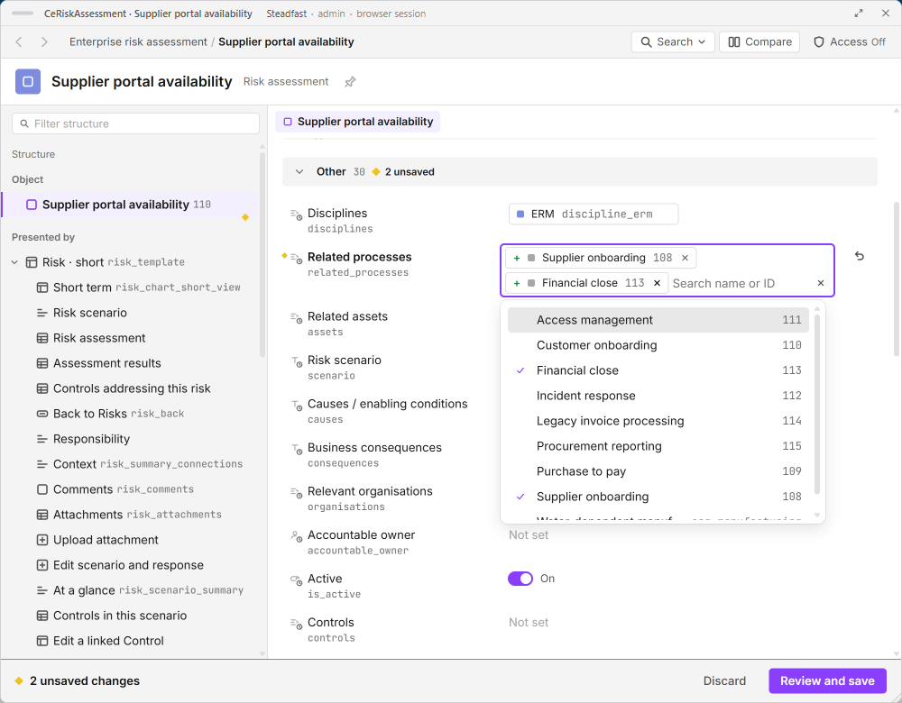
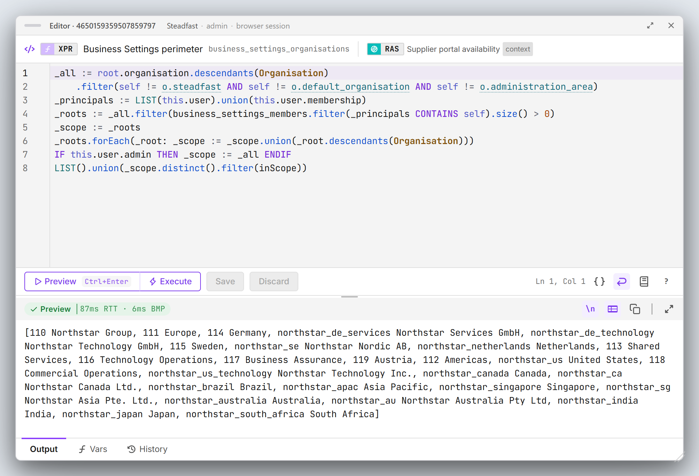
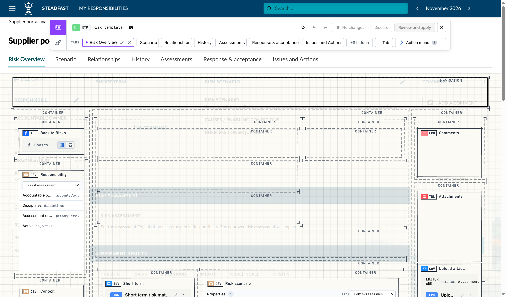
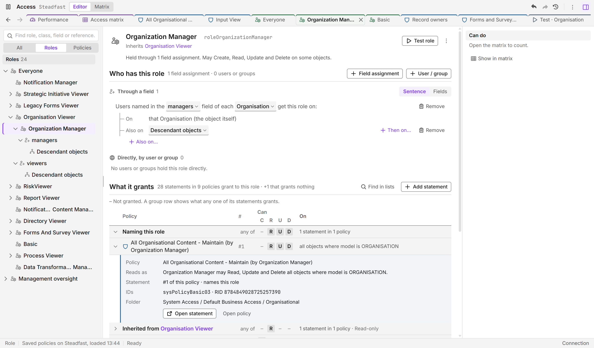
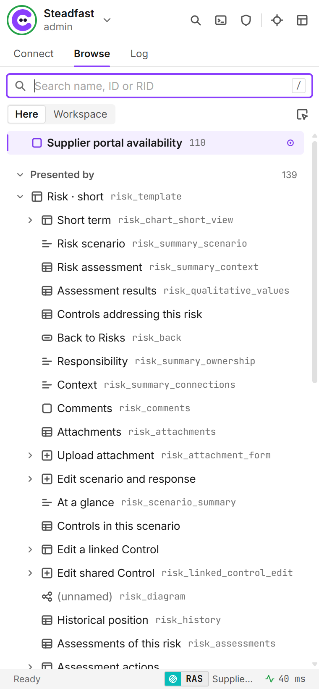
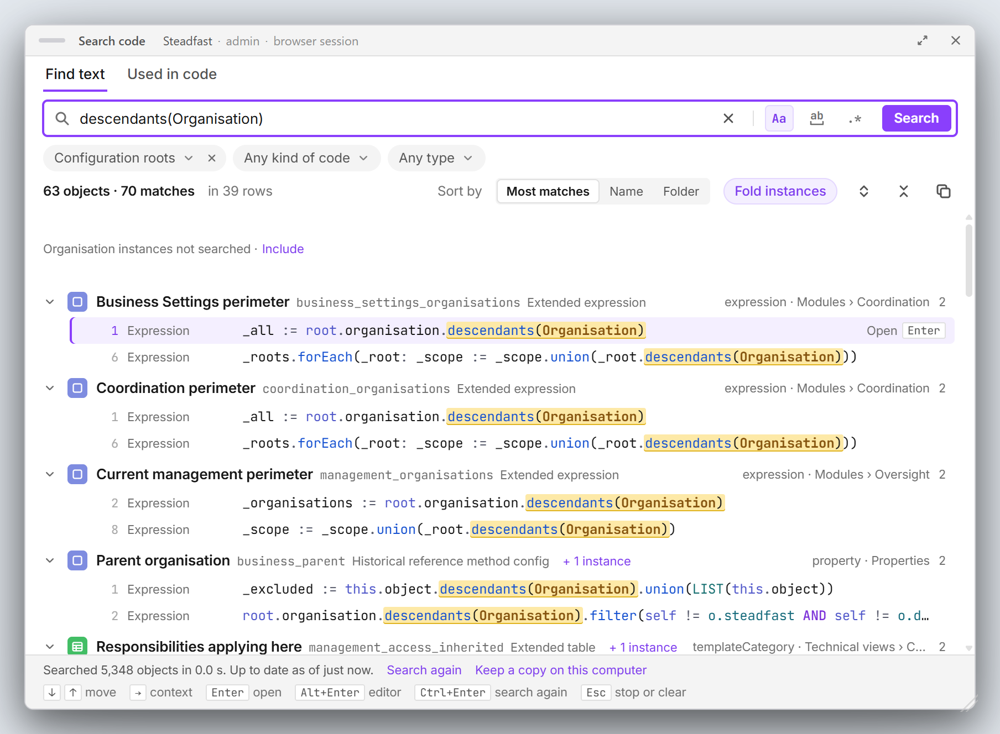
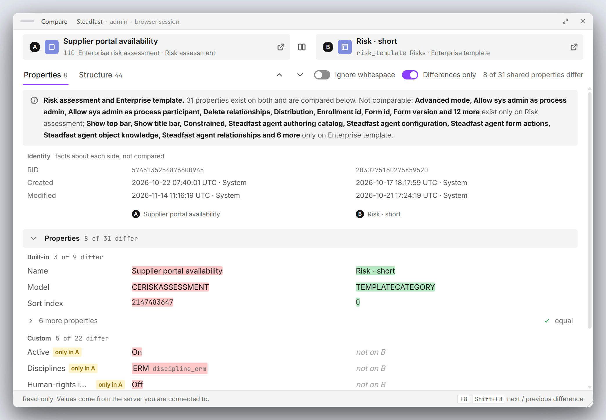

<p align="center">
  
</p>

<p align="center">
  <a href="https://github.com/HeinemannT/configuration-companion/releases/latest"></a>
  <a href="https://github.com/HeinemannT/configuration-companion/actions/workflows/ci.yml"></a>
  
</p>

<p align="center">
  <a href="#install">Install</a> ·
  <a href="#connect-to-bmp">Connect</a> ·
  <a href="#what-it-does">Features</a> ·
  <a href="#shortcuts">Shortcuts</a> ·
  <a href="https://github.com/HeinemannT/configuration-companion/releases">Releases</a> ·
  <a href="PRIVACY.md">Privacy</a>
</p>

Configuration Companion is a Chrome and Edge extension for people who configure Corporater BMP. It labels the objects on a BMP page, opens any of them in a window with its structure and properties, and lets you edit code, layout and access rules in the browser. Every write to BMP is shown for review before it is sent.

<p align="center">
  
</p>

## Install

1. Download `configuration-companion-x.y.z.zip` from the [latest release](https://github.com/HeinemannT/configuration-companion/releases/latest) and unzip it into a folder you will keep.
2. Open `chrome://extensions/` (Edge: `edge://extensions/`) and turn on **Developer mode**.
3. Choose **Load unpacked** and select the unzipped folder.
4. Pin Configuration Companion to the toolbar.

Chrome or Edge 116 or later is required.

To update, replace the contents of the same folder with the new release and click **Reload** for the extension. Loading a release from a different folder creates a second installation.

## Connect to BMP

The extension has no access to any website until you grant it. Under **Connect**, add your BMP workspace URL and approve the browser's site-access prompt. You can revoke access at any time in the browser's extension settings.

Then choose which identity runs configuration commands:

- **Use browser login** runs commands as the user signed in to the BMP page. Single sign-on works.
- **Use stored configuration login** uses a separate account saved in the extension. The website stays signed in as the portal user.

## What it does

### Inspect and the object window

Inspect outlines the objects on a BMP page and labels each with its ID and type. Click a label to copy the ID. Double-click it to open the object window: the structure of the page or object on the left, and its properties, references ("Used by") and a comparison with its template on the right.

Custom properties can be edited in the row, including references to other objects, lists of references and users. The changes are collected, shown as old and new values, and saved together. If someone changed a value in BMP after you opened the window, the save stops and shows both values.

<p align="center">
  
</p>

### Extended Code

An editor for Extended Code with syntax highlighting, completion and linting. Preview runs a script without committing it; Execute commits it. Text, HTML and CVO properties open in their own editors.

<p align="center">
  
</p>

### Blueprint

Blueprint rebuilds a page's tabs, containers, widgets and edit pages over the live page. The changes stay a local draft until you review and apply them.

<p align="center">
  
</p>

### Access

Edit roles and policies, see who has a role and what it grants, and test what a user or role can do. The test names the rule that grants the access.

<p align="center">
  
</p>

### Browse, Code Search and Compare

Browse shows the structure of the current page in the side panel and finds objects by name, ID or RID. Code Search searches the Extended Code of the whole workspace. Compare puts an object next to its template or another object.

<p align="center">
  
  &nbsp;
  
</p>

<p align="center">
  
</p>

### Atlas

Atlas opens in a browser tab and shows the types of a workspace and the reference properties between them. All types is a grid of which type references which. One type shows its references and how many objects fill each. Route lists the routes between two types, with their objects and the Extended Code that reads them.

### Transport (beta)

Transport moves configuration objects from one workspace to another. Find the objects by ID, name, change date or by browsing the tree, and take single objects or a folder with everything under it. Companion compares them with the target and shows what would be added, changed, moved or deleted. Apply runs a dry run first and writes nothing if the target changed since the comparison. The last apply can be undone, except for deletes. For a workspace that is not connected, Transport gives you the scripts to run there yourself.

Not transported: Process Management, custom periods, organisations and their linked copies. This is a beta: test a transport on a copy before using it on a production workspace.

### AI assistant (optional)

The assistant explains objects, drafts or revises code, and proposes changes. Nothing is written to BMP until you review and run it.

It is off until you set it up under **Connect → AI Assistant**. You supply your own key for Anthropic, OpenAI, DeepSeek, Grok, or a compatible endpoint. Requests go from your browser directly to that provider.

## Shortcuts

| Default | Action |
|---|---|
| `Ctrl+Shift+Y` | Open the side panel |
| `Ctrl+Shift+X` | Toggle Inspect |
| `Ctrl+Shift+E` | Open the Extended Code editor |
| `Ctrl+Shift+H` (`Cmd+Shift+K` on macOS) | Toggle Blueprint |
| none | Search the configuration (assign a key yourself) |

On macOS the first three use `Cmd`. Change them at `chrome://extensions/shortcuts`. Press `?` in a Companion window for the keys that work there.

## Privacy

The extension has no analytics and no developer-operated service. Data goes to your BMP server, to the AI provider you set up, and to GitHub for the update check. See [PRIVACY.md](PRIVACY.md).

## Licence

Proprietary. See [LICENSE](LICENSE) and [THIRD-PARTY-NOTICES.md](THIRD-PARTY-NOTICES.md).

## Development

```bash
npm ci
npm run verify
```
